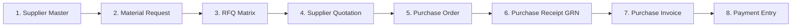

# ERPNext Buying & Procurement Cycle Engine (Request se Payment tak)

[](https://www.python.org/)
[](https://frappe.io)
[](https://erpnext.com)
[](LICENSE)
[]()
[]()

> **"Procurement — Request se Payment tak — Har kharid ka hisaab, ek jagah"**  
> End-to-end procurement and purchase cycle engine for Frappe & ERPNext managing purchase requisitions, supplier quotation comparison matrices, approved POs, GRN inspections, landed cost vouchers, and statutory tax accounting.

---

## 🎯 The Real-World Client Problem & Business Context

Procurement processes in growing organizations suffer from severe cost leakages:
1. **Unapproved Maverick Buying:** Department managers order goods directly from vendors without centralized Purchase Orders or budget checks, leading to inflated supplier invoices.
2. **Hidden Landed Freight Costs:** International ocean freight, port customs duty, and inland transport charges are recorded as general expenses rather than added to item inventory valuation, corrupting true gross margins.
3. **Invoice Price Creep:** Vendors invoice at rates higher than the agreed Purchase Order quotation, and manual accounts checks fail to identify the discrepancy before disbursement.

**This engine automates the 8-step standard ERPNext buying workflow:** Enforcing automated RFQ supplier ranking, multi-tier PO approval limits, Goods Receipt Note (GRN) quality acceptance, and Landed Cost Voucher value apportionment.

---

## 🏗️ Standard ERPNext Buying Workflow Flow



---

## ⚙️ Key Enterprise Features & Capabilities

- **Supplier Master:** Vendor groups, GSTIN registration status, MSME Udyam categorization, payment terms, and vendor performance scorecard.
- **Material Request:** Requisitions for purchase, inter-warehouse transfer, manufacturing material plan, and automated reorder level triggers.
- **RFQ & Comparison Matrix:** Distribute requests for quotation to multiple suppliers and evaluate line-by-line landed costs and lead times.
- **Purchase Order (PO):** Multi-level approval hierarchy, delivery schedules, tax templates, and auto-email dispatch to suppliers.
- **Purchase Receipt (GRN):** Partial receipts, warehouse bin putaway, serial number / batch allocation, and quality inspection linkages.
- **Purchase Invoice:** Automated 3-way matching against PO and GRN with input tax credit (ITC) and TDS Section 194Q compliance.
- **Landed Cost Voucher:** Accurately apportions overseas freight, customs duty, and port handling charges into inventory valuation.
- **Purchase Return:** Debit Notes, supplier returns, and automated stock ledger reversals.
- **India Ready:** Integrated handling for CGST, SGST, IGST, Reverse Charge Mechanism (RCM), Section 194Q TDS, e-Way Bill generation, and HSN code validation.

---

## 📂 Repository & Module Structure

```
erpnext-buying-procurement-cycle-engine/
├── buying_procure/
│   ├── __init__.py           # Package version & module exports
│   └── engine.py             # Procurement RFQ & Landed Cost Valuation engine
├── tests/
│   ├── __init__.py
│   └── test_buying_procure.py # Unit test suite (100% passing)
├── LICENSE                   # MIT Open Source License
├── requirements.txt          # Python dependencies
└── README.md                 # Complete documentation
```

---

## 🔌 Frappe DocType Schema Design

- **`Supplier`:** Supplier Name, GSTIN, MSME Type, Default Payment Terms, and Rating.
- **`Material Request`:** Item Code, Required Qty, Warehouse, and Purpose.
- **`Request for Quotation`:** Suppliers Invited, Items Required, and Submission Deadline.
- **`Purchase Order`:** Supplier, Items Child Table, Taxes and Charges, and Status.
- **`Purchase Receipt`:** Accepted Warehouses, Rejected Warehouses, and Quality Inspection ID.
- **`Landed Cost Voucher`:** Receipts Linked, Expense Accounts, and Apportioned Charges.

---

## 🚀 Installation & Setup

### 1. Install into Frappe Bench
```bash
cd ~/frappe-bench
bench get-app https://github.com/shyampandey1104/erpnext-buying-procurement-cycle-engine.git
bench --site [your-site-name] install-app erpnext_buying_procurement
```

### 2. Configure Event Hooks (`hooks.py`)
```python
doc_events = {
    "Purchase Order": {
        "before_submit": "buying_procure.engine.validate_procurement_budget"
    }
}
```

---

## 💻 Production Usage Example

```python
from buying_procure.engine import (
    ERPNextBuyingProcureEngine, SupplierQuoteItem,
    PurchaseOrderLine, LandedCostAllocation
)

engine = ERPNextBuyingProcureEngine()

# 1. Compare multiple vendor quotes in RFQ matrix
quotes = [
    SupplierQuoteItem("SUP-01", "Fast Logistics Ltd", "RAW-ALUMINUM", 280.0, tax_pct=18.0, lead_time_days=15),
    SupplierQuoteItem("SUP-02", "National Metals Co", "RAW-ALUMINUM", 265.0, tax_pct=18.0, lead_time_days=10)
]
optimal_supplier = engine.compare_supplier_quotations(quotes)
print(f"Selected Supplier: {optimal_supplier.supplier_name} at Rs. {optimal_supplier.unit_price}/unit")

# 2. Compute true inventory valuation via Landed Cost Voucher
po_lines = [
    PurchaseOrderLine("RAW-ALUMINUM", ordered_qty=100.0, unit_rate=265.0, tax_rate_pct=18.0),
    PurchaseOrderLine("RAW-COPPER", ordered_qty=50.0, unit_rate=600.0, tax_rate_pct=18.0)
]
charges = LandedCostAllocation(freight_charges=3500.0, customs_import_duty=5000.0, handling_fees=1500.0)

valuation = engine.compute_landed_item_valuation(po_lines, charges)
print(f"Effective Landed Rate for Aluminum: Rs. {valuation['RAW-ALUMINUM']}")
print(f"Effective Landed Rate for Copper:   Rs. {valuation['RAW-COPPER']}")
```

---

## 🧪 Testing & Verification

Run tests with standard Python:
```bash
python3 -m unittest discover tests
```

---

## 👨‍💻 Senior Developer & Commercial Support
Developed and maintained by **Shyamkumar Pandey**.  
For procurement automation, supplier portals, and enterprise ERPNext workflows:
- **GitHub:** [@shyampandey1104](https://github.com/shyampandey1104)
- **Email:** [shyampandey1104@gmail.com](mailto:shyampandey1104@gmail.com)
